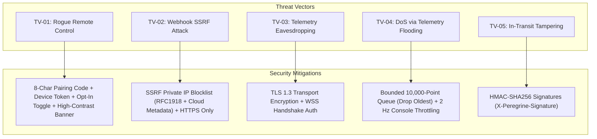

# Peregrine Threat Model and Security Architecture

## 1. Product Positioning & Explicit Non-Goals

Peregrine is an engineering testing tool designed for mobile developers, QA engineers, and fleet operations teams. Peregrine operates **strictly within standard Android platform boundaries**.

### Explicit Non-Goals (Enforced by Design):
1. **NO Hiding of Mock Flags**: Peregrine never hooks or tampers with `Location.isFromMockProvider()` or `Location.isMock()`. Testing applications and security SDKs will correctly detect that mock locations are active.
2. **NO Root or Xposed Hooks**: Peregrine does not require or support Magisk, KernelSU, Xposed, or Frida runtime instrumentation.
3. **NO Play Integrity or SafetyNet Bypass**: Peregrine does not alter device attestation verdicts or bypass Google Play Integrity API checks.
4. **NO Game/Consumer App Targeting**: Peregrine includes no features intended to cheat or bypass anti-cheat mechanisms in games or consumer location services.

---

## 2. Threat Vectors and Architectural Mitigations

### TV-01: Unauthorized Remote Fleet Control
- **Risk**: An attacker on the local network or internet dispatches commands to move a device without user knowledge or consent.
- **Mitigations**:
  - **Cryptographic Device Tokens**: Devices authenticate via a 256-bit cryptographically secure token exchanged during pairing.
  - **Ephemeral Pairing Codes**: Pairing codes are 8-character uppercase alphanumeric tokens expiring after 10 minutes with single-use redemption.
  - **Opt-In Consent Toggle (US-09)**: Remote control is disabled by default (`remote_control_enabled = false`). All incoming mutative commands are rejected if the toggle is off.
  - **High-Contrast Banner**: When remote control is active, a persistent high-contrast amber banner is rendered on the screen: `REMOTE CONTROL ACTIVE (FLEET)`.
  - **Immediate Revocation**: The device user can revoke remote control or unpair at any time with a single tap.

### TV-02: Server-Side Request Forgery (SSRF) via Webhooks
- **Risk**: A malicious user configures a webhook URL targeting internal cloud metadata services (`http://169.254.169.254/latest/meta-data`) or internal microservices (`http://10.0.0.5/admin`).
- **Mitigations**:
  - **Strict IP Range Blacklisting**: The `WebhookDispatcher` (`backend/src/services/webhookDispatcher.mjs`) validates target URLs before dispatch, strictly blocking:
    - `127.0.0.0/8` (Loopback)
    - `10.0.0.0/8`, `172.16.0.0/12`, `192.168.0.0/16` (RFC1918 Private Networks)
    - `169.254.0.0/16` (Link-Local & Cloud Instance Metadata Services)
    - `::1` and IPv6 private addresses
  - **Protocol Restriction**: Only `https://` is permitted in production environments (`http://` permitted only on local loopback testing).
  - **Strict Timeouts**: Webhook delivery requests time out after 5,000 ms to prevent connection exhaustion.

### TV-03: Webhook Payload Tampering
- **Risk**: An attacker tampers with geofence event alerts in transit.
- **Mitigations**:
  - Every webhook POST includes an HMAC-SHA256 signature in the `X-Peregrine-Signature` header computed over the raw payload using the shared webhook secret.

### TV-04: Denial of Service via Telemetry Flooding
- **Risk**: Disconnected devices or rogue simulators exhaust server memory by uploading millions of queued points.
- **Mitigations**:
  - **Bounded Offline Buffer**: The Android client enforces a strict 10,000-point buffer limit (`OfflineTelemetryQueue.kt`). When full, the oldest points are dropped (`dropOldest`) rather than accumulating unbounded points.
  - **Console Throttling**: The `/ws/console` broadcast is throttled to at most 2 Hz per device, preventing browser UI freezes regardless of incoming client ingestion rates.

### TV-05: XML External Entity (XXE) Injection
- **Risk**: Malicious GPX or KML files imported by users contain `<!DOCTYPE>` entity expansion attacks.
- **Mitigations**:
  - `GpxFileIo.kt` and `KmlFileIo.kt` explicitly configure `DocumentBuilderFactory` with:
    - `http://apache.org/xml/features/disallow-doctype-decl = true`
    - `external-general-entities = false`
    - `external-parameter-entities = false`
